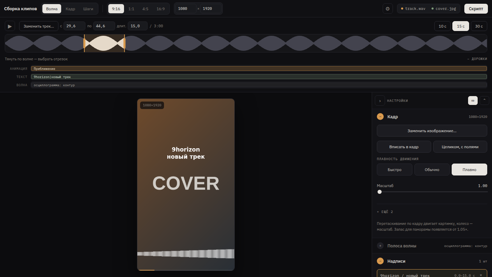

# Clipper

**English** · [Русский](README.ru.md)

A browser tool that turns a cover image and a track into a vertical clip.
You pick the segment on the waveform, frame the picture with the mouse, add
captions, motion and a waveform strip — and get a ready bash script that
renders the file with ffmpeg.



## Quick start

```bash
git clone https://github.com/cs-eliseev/clipper.git
cd clipper
xdg-open index.html        # macOS: open index.html
```

Then:

1. Drop a WAV or MP3 onto the waveform, drop a cover onto the frame.
2. Drag over the wave to pick the segment — take the hook, not the intro.
3. Frame the picture: drag moves it, the wheel zooms.
4. Add captions and motion in the panel on the right.
5. Press **Script**, copy it, and run it from your project directory:

```bash
bash clip.sh              # or paste the script straight into a terminal
```

Rendering needs `ffmpeg` and `python3` — the browser part needs nothing.

```bash
ffmpeg -version && python3 --version
```

## Three layouts

The switch in the header changes how the same editor is arranged. Nothing else
changes — the clip, the panel and the script are shared.

| Layout | Arrangement | Good for |
| --- | --- | --- |
| **Wave** | timeline across the top, frame in the middle, settings on the right | working from the track: you hear the segment first |
| **Frame** | frame in the middle, timeline underneath it, settings on the right | working from the picture: the frame gets the most room |
| **Steps** | panel on the left starting with “Track and segment”, frame on the right | going through the clip step by step |

## What it does

- **Segment on the waveform** — drag to select, drag inside to move, drag an
  edge to resize. `Space` plays it together with the preview.
- **Live frame preview** that repeats the motion maths of `render-clip.py`, so
  what you see is what gets rendered.
- **Direct manipulation.** Drag the picture, the waveform strip or a caption
  right on the frame; the wheel zooms the picture, widens the strip or rotates
  the caption. The matching panel block opens by itself.
- **Motion** — push in, pull out, four pans and a dim. Zoom, horizontal and
  vertical are independent lanes, so a push and a pan run at the same time;
  separate the intervals to play them in turn. Conflicts on one axis are flagged.
- **Captions** with a font, colour, opacity, tilt, timing and fade-in and
  fade-out speeds; `|` breaks a line.
- **Lanes under the wave** — a ruler in seconds of the segment (click to seek),
  a playhead and a lane each for frames, motion, captions and the spectrum.
  Motion and captions can be expanded to one row per item.
- **Any slider value can be typed**: click the number on the right, type,
  Enter. ↑↓ step by one increment, ten with Shift.
- **Spectrum** — ten kinds, from oscilloscope outlines to a vectorscope,
  with colour, opacity and an outline.
- **Frame sizes** 9:16, 1:1, 4:5, 16:9 or any custom pair.
- **Frames and thumbnail** — an opening and a closing image, each with its own
  duration and transition: hard cut, fade, slide, slide and fade, grow and
  fade. The transition plays over the clip without shortening it; the track
  keeps playing under both frames.
- **Explorer thumbnail** (same block) — the mp4 poster: a frame of the finished clip at a
  chosen second or your own image, embedded as cover art and optionally saved
  next to the video as a `.jpg`.
- **A list of clips** — put several clips aside and get one script for all of them.
- **Languages and themes** — Russian and English included, your own are loaded
  as a file right in the interface (⚙ in the header) or kept next to `index.html`.

The layout, the open blocks, the frame size, the paths, the language and the
theme are remembered between sessions (`localStorage`).

## Rendering

`render-clip.py` reads one clip description from a file or from stdin and calls
ffmpeg:

```bash
./render-clip.py clip.json
./render-clip.py < clip.json
./render-clip.py --print-cmd clip.json    # show the ffmpeg command, run nothing
```

The description — only `image`, `audio` and `out` are required:

```json
{
  "image": "cover.jpg",
  "audio": "track.wav",
  "frame": [1080, 1920],
  "start": 45.0,
  "duration": 15.0,
  "out": "clip01.mp4",
  "img": { "scale": 1.0, "x": 0.5, "y": 0.5, "fit": "cover" },
  "smooth": 3,
  "anims": [
    { "type": "zoomin",   "speed": 1.0, "from": 0, "to": 7.5 },
    { "type": "panright", "speed": 1.0, "from": 7.5, "to": 15 },
    { "type": "dim", "value": 0.45, "from": 2, "to": 10, "fadeIn": 0.5, "fadeOut": 0.5 }
  ],
  "wave": {
    "on": true, "type": "wave-cline", "freq": 0.5,
    "x": 0.5, "y": 1620, "w": 1080, "h": 240,
    "color": "#ffffff", "alpha": 0.85,
    "outline": { "on": true, "color": "#000000", "size": 2 }
  },
  "texts": [
    { "text": "first line|second", "x": 540, "y": 960, "angle": -4,
      "size": 64, "color": "#ffffff", "font": "/path/font.ttf",
      "from": 0, "to": 15, "fadeIn": 0.6, "fadeOut": 0.6 }
  ],
  "intro": { "image": "title.png", "duration": 2.0, "anim": "slidefade",
             "dir": "left", "animDur": 0.6, "audioFade": 0.5 },
  "outro": { "image": "credits.png", "duration": 3.0, "fit": "contain",
             "anim": "fade", "animDur": 0.8, "audioFade": 1.0 },
  "thumbnail": { "mode": "frame", "time": 4.5, "save": true }
}
```

The frames stretch the timeline: `duration` is how long a frame holds; the
seconds of the track *before* the segment play under the intro, the ones
*after* it under the outro. Transitions: `cut`, `fade`, `slide`, `slidefade`,
`zoom`; `dir` is the slide direction. The thumbnail is either `frame` (a frame
of the finished clip at second `time` on the full timeline) or `image` (your
own picture); `save` also writes a `.jpg` next to the video. GNOME and KDE
show the embedded cover, Windows and macOS usually take the first video
frame — that is, the intro.

Run `./render-clip.py --help` — the module docstring documents every field.

### make-clip.sh

A smaller CLI for a single clip without the editor:

```bash
./make-clip.sh -i cover.jpg -a track.wav -s 45 -d 15 -m wave -o clip01.mp4
```

## Tests

No dependencies — everything runs on built-in tooling:

```bash
npm test          # 62 renderer tests on the standard unittest
npm run smoke     # an interface run in a real browser
npm run check     # both
```

or without npm: `python3 -m unittest discover -s tests -v`.

**`tests/test_render_clip.py`** covers `render-clip.py`, where a mistake is the
most expensive: a wrong filter produces a broken video and you only find out
after a long render. ffmpeg itself is never launched — what is compared is what
it would be given: zoompan expressions, dim layers, the filters of all ten strip
kinds, caption escaping, frame size, the intro/outro layers and the audio
timeline under them, the thumbnail commands, plus an end-to-end `--print-cmd`
run including the error paths.

**`npm run smoke`** opens the page in a headless browser and walks the user's
path: drop a track and a cover, pick a segment, switch layouts, turn the strip
on, add a caption and a motion, set an intro, an outro and a thumbnail, build
the script, switch language and theme.

The browser half is covered by that run only: its logic lives in the global
scope and is genuinely testable only together with the page. Splitting it into
modules the way [Cropper](https://github.com/cs-eliseev/cropper) is arranged is a separate job; unit tests
will follow it.

## Paths

The browser never reveals the full path of a dropped file, so the script builds
paths from **Working directory** plus the file names. If a track or a cover sits
in a subfolder, add it to the name. **Renderer path** is what the script calls —
`./render-clip.py` when this repo is the working directory.

## Fonts

The font list points at the usual Linux paths (DejaVu, Liberation, FreeFont).
On another system, edit `fonts` in `config.js` — the renderer only needs a
readable `.ttf` path:

```js
fonts: [
  { n: 'Helvetica', f: '/System/Library/Fonts/Helvetica.ttc' }
]
```

## Your own languages

The language is switched under ⚙ in the header, next to two buttons:

- **File…** — load your own dictionary from disk, `.json` or `.js`;
- **Template** — download the current dictionary to translate it.

The usual order: download the template, translate the strings, load it back.
The dictionary stays in the browser and is picked up on the next launch.

To have a language in the set from the start, drop the file into `lang/` and
add it to `index.html` next to the others:

```html
<script src="lang/es.js"></script>
```

A dictionary file is a single call:

```js
App.lang({
  code: 'es',
  name: 'Español',
  dir: 'ltr',                 // 'rtl' for Arabic or Hebrew
  strings: { appTitle: 'Montaje de clips', blockImage: 'Cuadro' }
});
```

The same object without the wrapper is valid `.json` for the ⚙ picker. Keys
your translation does not cover come from the fallback language
(`fallbackLang` in `config.js`), so a partial translation breaks nothing.

## Your own themes

A theme is a file of tokens and nothing else: `themes/dark.css` lists the
whole set with comments. The tokens are the same in Clipper and Cropper, so a
theme can be carried between them unchanged.

A file loaded through ⚙ → Theme → File… **layers over** the selected theme
instead of replacing it — overriding a few tokens is enough:

```css
:root {
  --acc: #2f7fbf;
  --wave-peak: #6f8fa8;
}
```

A theme meant to stay is easier to keep next to the page and declare in
`config.js`:

```js
App.theme({ id: 'sand', name: 'Sand', href: 'themes/sand.css' });
```

The frame itself stays dark under every theme — it is the content of the clip,
not the interface, and the preview must not lie about what lands in the file.

Markup and metrics live in `css/app.css`, which holds no colours at all. The
classes are BEM, so overriding a single block from your own file is easy too:
`.track__clip--anim { … }`.

## Settings (config.js)

| Key | What it sets |
| --- | --- |
| `lang`, `fallbackLang` | language at first launch (`auto` follows the browser) and the fallback |
| `theme` | theme at first launch |
| `variant`, `variants` | the layout to start with and the list of available ones |
| `blocks.order`, `.hidden`, `.open` | order of the panel blocks, what to hide, what to open |
| `formats`, `frame` | frame formats and the default size |
| `lengths`, `duration`, `minDuration`, `maxDuration` | quick segment lengths and the limits |
| `renderer`, `baseDir`, `outName` | what goes into the generated script |
| `fonts`, `defaultFont` | caption fonts |
| `previewLong` | long side of the preview canvas |

The user always wins: layout, language, theme and panel state stay in the
browser. **Reset mine** under ⚙ brings everything back to `config.js`.

## Project layout

```
index.html          markup — BEM classes only, no inline styles
config.js           settings: language, theme, blocks, formats, fonts, paths
css/app.css         blocks and metrics — not a single colour, all tokens
themes/dark.css     dark theme: the full list of tokens
themes/light.css    light theme
lang/ru.js          Russian dictionary
lang/en.js          English dictionary
js/registry.js      extension registry: languages, themes, settings
js/i18n.js          language choice and string substitution
js/theme.js         themes and the tokens used by canvas drawing
js/state.js         constants, clip description, interface state
js/audio.js         decoding, peaks, playback
js/preview.js       the frame: drawing and mouse
js/timeline.js      the waveform, the segment, the lanes
js/inspector.js     panel sliders built from data
js/frames.js        intro and outro frames, the explorer thumbnail
js/queue.js         the clip list and the script
js/colorpicker.js   the colour popover
js/app.js           layouts, panel, header
render-clip.py      the renderer (ffmpeg)
make-clip.sh        a single-clip CLI
docs/               screenshots
```

The CSS follows BEM: `block`, `block__element`, `block--modifier`. Every rule
starts with a class, so markup and styles can be read side by side.

## License

MIT — see [LICENSE](LICENSE).
